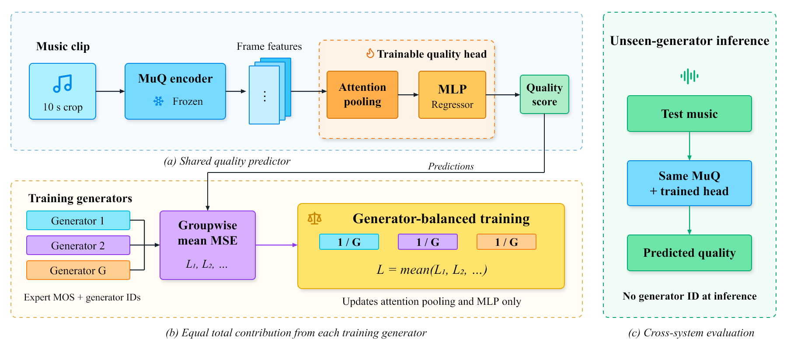

<div align="center">

# GeM-Q

### Generator-Balanced Music Quality Assessment

Frozen MuQ features. A lightweight quality head. Equal weight for every training generator.

[Method](#method) · [Results](#results) · [Quick start](#quick-start) · [Protocol](docs/protocol.md)

</div>



## Method

GeM-Q changes the training objective of a music quality predictor without changing its inference pipeline. A frozen MuQ encoder supplies frame representations to an attention-pooling MLP. Instead of averaging all clip losses equally, GeM-Q averages the mean loss of each training generator.

```text
Generator loss:   L_g = mean squared error within generator g
Balanced loss:    L_GB = mean of L_g across training generators
Clip weight:     alpha_i = N / (G * n_g)
```

Here `N` is the number of training clips, `G` the number of training generators, and `n_g` the training clip count for generator `g`. The weighted minibatch loss divides by batch size, not by the batch's weight sum. Generator IDs are not inputs to the scorer.

This repository contains a controlled, quality-only reproduction of the MuQ-Eval A1-style head. It does **not** reproduce MuQ-Eval's published benchmark numbers. `gb` is GeM-Q, `erm` is clip-average training, and `sgb` is the adaptive-weighting control.

## Results

MusicEval, five generator-disjoint folds, three seeds. Scores below are means across seeds. Lower MAE is better.

| Training objective | Seen-generator MAE | Unseen-generator MAE | Unseen pooled SRCC |
|:--|--:|--:|--:|
| ERM | 0.3881 | 0.4327 | 0.7913 |
| **GeM-Q (GB)** | **0.3799** | **0.4254** | **0.7971** |
| SGB, adaptive control | 0.3799 | 0.4254 | 0.7970 |

GeM-Q reduces unseen-generator macro MAE by **1.7%**. The paired generator-bootstrap interval for GB minus ERM is `[-0.0139, -0.0011]` MOS. Adaptive weighting adds no measurable benefit. The upper-quartile generator error becomes worse, and the seen/unseen gap does not shrink.

The study includes **74 fitted heads**: 45 cross-generator main runs, nine seen-generator controls, and 20 sensitivity runs. See [per-seed metrics](reported/metrics.csv), [generator errors](reported/generator_errors.csv), and the [full numerical summary](reported/summary.json).

## Quick start

Use Linux, Python 3.12, and an NVIDIA GPU. The experiments used a 32 GB GPU. Downloads require several GB; the frame cache occupies about 1.41 GB. Dataset and model files are fetched from their original repositories and are not redistributed here.

```bash
git clone https://github.com/TonyWang2182/GeM-Q.git
cd GeM-Q
python3 -m venv .venv
source .venv/bin/activate
pip install -r requirements.txt

python provision.py
python extract.py
python train.py --suite all
python evaluate.py
```

Install a PyTorch build compatible with your GPU driver if necessary. To use the same CUDA build as the experiment, install `torch==2.5.1` and `torchaudio==2.5.1` from the official `cu124` wheel index before the remaining requirements. On AutoDL, its official network acceleration can be enabled for downloads. A package mirror is optional and does not change the experiment.

`--suite main` runs the 54 main/control fits. `--suite sensitivity` runs the 20 fixed sensitivity fits. Completed run folders are reused; use a fresh results directory when changing the implementation or protocol.

```bash
# CPU-compatible unit tests, after installing the dependencies
python -m unittest test_protocol.py
```

## Repository layout

```text
provision.py        Pinned dataset/model downloads
extract.py          Center-crop features and input integrity checks
train.py            Quality head, partitions, and matched training suites
evaluate.py         Per-seed metrics and paired generator bootstrap
test_protocol.py    Split, weighting, and head tests
docs/protocol.md    Experimental settings and evaluation boundaries
reported/           Small, read-only summaries from the completed study
assets/             Overview image and icon attribution
```

## Evaluation boundaries

- Official MusicEval partitions are pooled for a **new generator-disjoint protocol**. These are not official benchmark test scores.
- Validation generators select checkpoints. Test MOS never updates weights or selects epochs.
- Generator-disjoint does not mean prompt-disjoint or model-family-disjoint.
- The experiment uses one corpus, one encoder, and a center crop. It does not demonstrate better generated music or reinforcement-learning outcomes.
- Summary tables describe the completed study. A fresh environment should be checked before interpreting small numerical differences.

## Acknowledgments and resources

[MusicEval](https://huggingface.co/datasets/BAAI/MusicEval) provides the ratings and audio. [MuQ](https://github.com/tencent-ailab/MuQ) provides the frozen representation model. [MuQ-Eval](https://github.com/dgtql/MuQ-Eval) motivates the attention-pooling head. The adaptive control follows [GroupDRO](https://arxiv.org/abs/1911.08731). Follow each upstream dataset/model license and access terms.

The overview uses [Lucide](https://github.com/lucide-icons/lucide) SVG icons. Their license is included in [assets/LICENSE-lucide.txt](assets/LICENSE-lucide.txt).
